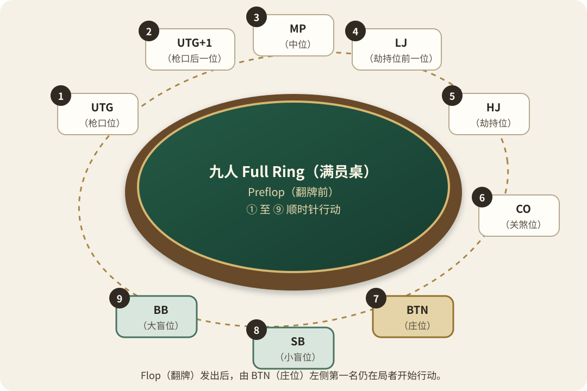

# 第一卷 第二章 第三篇：庄盲定位 轮转有序——Position（位置）

一枚圆钮，定下全桌先后。

灵石尚未入池，Hole Cards（底牌）尚未发出，BTN（庄位）与 Blinds（盲注）已经划定此局的起点。

先找庄位，再认双盲，最后确认当前行动者。

三者既明，阵序自清。

## 圆钮逐手 诸位随迁

实体牌桌由 Dealer（发牌员）执掌牌堆，BTN（庄位）则标记名义庄家位置。

一局结束以后，BTN（庄位）通常沿顺时针方向移动一席。

圆钮一动，各席名称随之更替。

上一局尚在后位，下一局便可能落入盲位。

座位未变，身处的局势却已不同。

若席位空缺或人数改变，道场可能采用 Dead Button（空庄位）处理轮转。

此时不可擅自移动圆钮。

应以 Dealer（发牌员）的指示与 House Rules（牌室规则）为准。

## 双盲先落 底池初成

BTN（庄位）左侧第一席，通常为 SB（小盲）。

再向左一席，则为 BB（大盲）。

二者必须在发牌前投入 Blinds（盲注），使 Pot（底池）在众人行动以前便已有所争。

盲注只是强制投入，并不代表该席已经完成行动。

若 Preflop（翻牌前）无人 Raise（加注），行动回到 BB（大盲）时，BB（大盲）仍可选择 Check（过牌）或 Raise（加注）。

看见盲注已在桌面，不可误认其已经失去行动权。

## 翻前枪口 依次而行——Preflop（翻牌前）

正常双盲结构下，Preflop（翻牌前）由 BB（大盲）左侧第一席率先行动。

此位称为 UTG（枪口位）。

此后行动沿顺时针方向传递，直至轮回盲位。

九人 Full Ring（满员桌）的庄盲位置与 Preflop（翻牌前）行动顺序如下：

  

| 行动次序 | 位置 | 中文名称 |
| --- | --- | --- |
| 1 | UTG（枪口位） | 枪口位 |
| 2 | UTG+1（枪口后一位） | 枪口后一位 |
| 3 | MP（中位） | 中位 |
| 4 | LJ（劫持位前一位） | 劫持位前一位 |
| 5 | HJ（劫持位） | 劫持位 |
| 6 | CO（关煞位） | 关煞位 |
| 7 | BTN（庄位） | 庄位 |
| 8 | SB（小盲） | 小盲位 |
| 9 | BB（大盲） | 大盲位 |

八人 Full Ring（满员桌）通常会省去一个前位或中位称呼。

不同道场的称谓可能略有差异。

席位多少可以改变，行动轮转不可混乱。

## 翻后左起 顺时而行——Postflop（翻牌后）

Flop（翻牌）发出以后，牌局进入 Postflop（翻牌后）。

此后每轮行动，均由 BTN（庄位）左侧第一名仍在局者开始。

已经弃牌者与空缺席位，直接越过。

行动仍沿顺时针方向传递。

若 BTN（庄位）仍在局中，通常会在该轮最后行动。

因此，Preflop（翻牌前）与 Postflop（翻牌后）的起始席位并不相同。

每逢新一轮开始，都应重新确认当前行动者。

不可沿用上一轮的先后印象。

## 离席归阵 盲债须清——Missed Blind（错过盲注）

暂时离席时，BTN（庄位）与 Blinds（盲注）通常仍会继续轮转。

若归座时已经错过 BB（大盲），道场可能放置 Missed Blind（错过盲注）标记。

此后是等待 BB（大盲）自然轮到，还是立即补交盲注，应依 House Rules（牌室规则）处理。

更换座位也可能产生新的盲注责任。

归座或换位以后，不宜自行判断。

先向 Dealer（发牌员）说明情况，再按裁定入局。

盲债未清，阵位便未真正归正。

## 手札一记

先辨庄盲，再循次序。

圆钮、双盲与当前行动者既明，每一次选择才能落在自己的位置。

## 本篇三省

1. 入局以前，是否依据 BTN（庄位）与 Blinds（盲注）确认了行动次序？
2. 行动之时，是否曾抢先出手，或混淆 Preflop（翻牌前）与 Postflop（翻牌后）的起始席位？
3. 下一次入局，能否先查圆钮、再查双盲、最后确认当前行动者？

## 本篇牌道术语

| 英文名称 | 规范缩写 | 中文含义 | 简要释义 |
| --- | --- | --- | --- |
| Cutoff | CO | 关煞位 | BTN（庄位）右侧第一席，属于主要后位之一。 |
| Dead Button | — | 空庄位 | 因席位空缺或人数变化，庄家按钮暂时停在无人位置的处理方式。 |
| Flop | — | 翻牌 | 同时发出的前三张公共牌，也指相应的下注轮次。 |
| Hijack | HJ | 劫持位 | CO（关煞位）右侧第一席。 |
| Lojack | LJ | 劫持位前一位 | HJ（劫持位）右侧第一席。 |
| Middle Position | MP | 中位 | 位于前位与后位之间的位置。 |
| Missed Blind | — | 错过盲注 | 玩家离席或换位时未按正常轮转投入的盲注。 |
| Postflop | — | 翻牌后 | Flop（翻牌）发出后的所有牌局阶段。 |
| Preflop | — | 翻牌前 | 玩家取得底牌后、翻牌发出前的首轮行动阶段。 |
| Small Blind | SB | 小盲／小盲位 | BTN（庄位）左侧通常需要投入较小强制盲注的位置。 |
| Under the Gun | UTG | 枪口位 | BB（大盲）左侧第一席，正常双盲结构下翻牌前率先行动。 |
| Under the Gun Plus One | UTG+1 | 枪口后一位 | UTG（枪口位）之后的下一位置。 |

[返回本章目录](./README.md)
