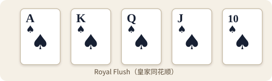
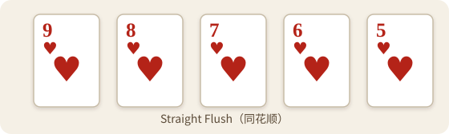
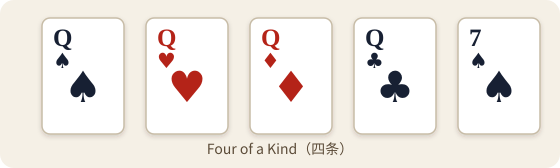
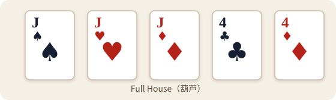
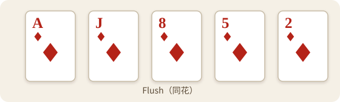
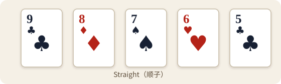
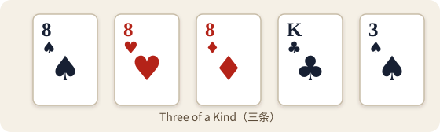
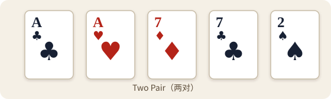
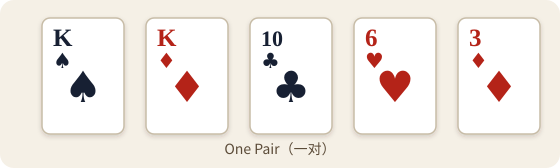
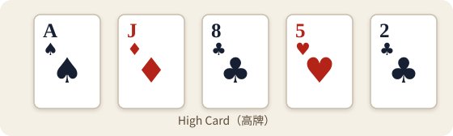

# 第一卷 第二章 第四篇：成牌之法 择五定胜——Best Five-Card Hand（最佳五张成牌）

七牌齐现，并非尽数入阵。

Texas Hold’em（德州扑克）只认最强五张。
识得牌型次序，方能断胜负，分高下。

## 七牌择五 唯取最强

摊牌之时，每名仍在局中的修士，最多可见七张牌：

- 两张底牌；
- 五张公共牌。

从中选出最强的五张，即为 Best Five-Card Hand（最佳五张成牌）。

底牌并非必须尽用。
可以用两张，也可以只用一张，甚至一张不用。

余下两张牌不参与比较。
六张成牌、七张成牌，皆不存在。

若五张公共牌已经强过底牌能够组成的一切结果，便应 Play the Board（公牌成牌）。
此时，底牌再亮眼，也不能改变最终牌力。

## 十型有序 强弱分明——Hand Ranking（牌型大小）

牌型由强至弱，共分十等。

**一、Royal Flush（皇家同花顺）**

由同一花色的 A、K、Q、J、10 组成。

这是最高的 Straight Flush（同花顺）。
牌至此境，再无更高。

  

**二、Straight Flush（同花顺）**

五张牌点数连续，且花色相同。

同为 Straight Flush（同花顺）时，以顺子最高牌的点数定胜负。

  

**三、Four of a Kind（四条）**

四张点数相同的牌，配合另一张牌组成五张成牌。

先比较四条的点数。
四条相同，再比较余下的 Kicker（踢脚牌）。

  

**四、Full House（葫芦）**

三张同点数牌，配合另一组对子。

同为 Full House（葫芦）时，先比较三条的点数。
三条相同，再比较对子的点数。

  

**五、Flush（同花）**

五张牌花色相同，但点数并不连续。

同为 Flush（同花）时，从最高牌开始逐张比较。
前牌相同，方比后一张。

  

**六、Straight（顺子）**

五张牌点数连续，花色不必相同。

同为 Straight（顺子）时，只比较顺子的最高牌。

  

**七、Three of a Kind（三条）**

三张点数相同的牌，配合两张其他点数牌。

先比较三条。
三条相同，再依次比较两张 Kicker（踢脚牌）。

  

**八、Two Pair（两对）**

两组不同点数的对子，配合另一张牌。

先比较较大的对子。
大对相同，再比较小对；两对皆同，最后比较 Kicker（踢脚牌）。

  

**九、One Pair（一对）**

两张点数相同的牌，配合三张其他点数牌。

先比较对子。
对子相同，再由最高的 Kicker（踢脚牌）开始逐张比较。

  

**十、High Card（高牌）**

未组成一对或更高牌型时，便以 High Card（高牌）定胜负。

从最高牌开始逐张比较。
直至分出高下，或五张完全相同。

  

## 同型相较 逐级定胜

先辨牌型，再比点数。

牌型不同，依十型次序直接定胜。
牌型相同，则按各自法度逐级比较：

- Straight Flush（同花顺）与 Straight（顺子），比较最高牌；
- Four of a Kind（四条），先比四条，再比 Kicker（踢脚牌）；
- Full House（葫芦），先比三条，再比对子；
- Flush（同花）与 High Card（高牌），由最高牌向下逐张比较；
- Three of a Kind（三条），先比三条，再比两张 Kicker（踢脚牌）；
- Two Pair（两对），先比大对，再比小对，最后比 Kicker（踢脚牌）；
- One Pair（一对），先比对子，再依次比较三张 Kicker（踢脚牌）。

比较一旦分出高下，便无需再看余牌。
未进入最强五张的牌，不具裁决之力。

## 顺路首尾 法界须明

A 既可居于牌序之巅，也可落于牌序之首。

A、K、Q、J、10，是 A 高 Straight（顺子）。
A、2、3、4、5，则是五高 Straight（顺子）。

在五高 Straight（顺子）中，A 只作低牌使用。
因此，A、2、3、4、5 会败给 2、3、4、5、6。

A 不能横跨首尾。
Q、K、A、2、3 不构成 Straight（顺子）。

首尾虽可变，牌序不可断。
这是顺子法界，不因花色或底牌而改。

## 踢脚虽微 亦能决胜——Kicker（踢脚牌）

Kicker（踢脚牌）不属于对子、两对、三条或四条的主体结构。

主体牌力相同之后，它才出面定胜。
但只有进入最强五张的 Kicker（踢脚牌），才有比较资格。

例如公共牌为：

A♣、A♦、9♠、6♥、2♣

一方持有 K♠、Q♠，组成：

A♣、A♦、K♠、Q♠、9♠

另一方持有 K♥、J♥，组成：

A♣、A♦、K♥、J♥、9♠

双方皆为 One Pair（一对），对子相同。
第一张 Kicker（踢脚牌）也同为 K，继而比较 Q 与 J。

Q 更高，前者胜出。

若某张底牌未能进入最终五张，它便只是阵外之牌。
不能因它看似强盛，便擅自加入比较。

## 公牌成阵 同高均分——Split Pot（平分底池）

若五张公共牌已经构成所有人的最佳五张，便是 Play the Board（公牌成牌）。

例如公共牌为：

A♠、K♦、Q♣、J♥、10♠

所有仍有资格争夺底池的修士，皆以这五张公共牌组成 A 高 Straight（顺子）。
各自底牌无法再令牌力提升。

此时，众人最终五张完全相同。
相应底池应作 Split Pot（平分底池）。

花色亦无高低之分。
黑桃不会天然胜过红桃，方块也不会压过梅花。

五张成牌全同，便是平局。
不得另择第六张或第七张牌强分胜负。

## 手札一记

七牌在前，只取五强。
先定牌型，再比点数；五张尽同，便应平分。

## 本篇三省

1. 判断胜负时，是否准确选出最强五张，并辨明所属牌型？
2. 比牌过程中，是否误将第六张、第七张、花色或阵外底牌算入结果？
3. 下一次摊牌时，能否依照“先定牌型、再比点数、最后确认平局”的次序完成判断？

## 本篇牌道术语

| 英文名称 | 规范缩写 | 中文含义 | 简要释义 |
| --- | --- | --- | --- |
| Flush | — | 同花 | 五张花色相同、点数不连续的牌。 |
| Four of a Kind | — | 四条 | 四张点数相同的牌，配合另一张牌组成的牌型。 |
| Full House | — | 葫芦 | 三张同点数牌与另一对同点数牌组成的牌型。 |
| High Card | — | 高牌 | 未组成一对或更高牌型时，以最高点数牌为主要比较依据的牌型。 |
| Kicker | — | 踢脚牌 | 不属于主要成牌结构，但在主体牌力相同后参与比较的牌。 |
| One Pair | — | 一对 | 两张点数相同的牌，加上三张其他点数牌组成的牌型。 |
| Play the Board | — | 公牌成牌 | 最佳五张完全由五张公共牌组成，不使用任何底牌。 |
| Royal Flush | — | 皇家同花顺 | 由同一花色的 A、K、Q、J、10 组成的最高同花顺。 |
| Split Pot | — | 平分底池 | 两名或以上有资格争夺的玩家最终牌力相同，按规则平分相应底池。 |
| Straight | — | 顺子 | 五张点数连续、花色不必相同的牌。 |
| Straight Flush | — | 同花顺 | 五张点数连续且花色相同的牌。 |
| Three of a Kind | — | 三条 | 三张点数相同的牌，加上两张其他点数牌组成的牌型。 |
| Two Pair | — | 两对 | 两组不同点数的对子，加上另一张牌组成的牌型。 |

[返回本章目录](./README.md)
